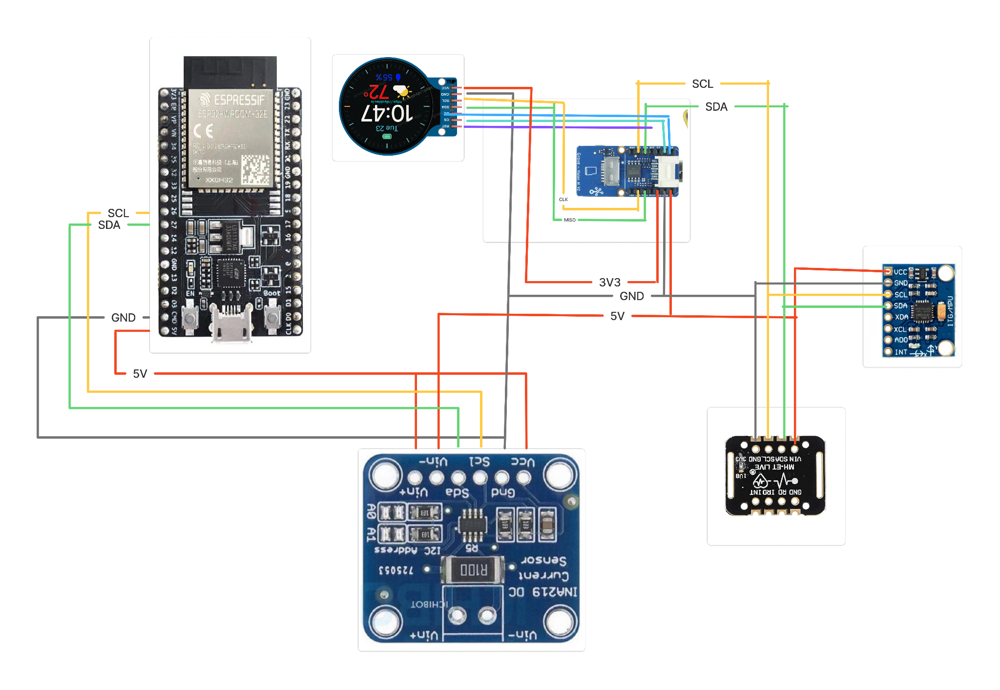

# Power Consumption Grove Vision AI V2 (ESP32 + INA219)

Alat sederhana untuk mengukur **tegangan, arus, dan daya** dari Seeed Grove Vision AI V2
menggunakan ESP32 dan sensor arus INA219. Hasil pengukuran dipakai untuk memperkirakan
kebutuhan baterai pada aplikasi *wearable* (misalnya *sleep staging* atau estimasi HR/SpO2).

```
power-monitor-ina219/
  power-monitor-ina219.ino   <- satu-satunya sketch yang perlu di-upload
docs/
  wiring.png                 <- diagram rangkaian
```

---

## 1. Alat dan bahan

| Komponen | Fungsi |
|---|---|
| ESP32 DevKit (ESP32-WROOM-32E) | Sumber 5 V untuk Grove Vision dan pembaca data INA219 |
| INA219 (shunt 0,1 Ω) | Sensor tegangan & arus, dipasang seri di jalur 5 V |
| Seeed Grove Vision AI V2 | Perangkat yang diukur |
| MPU6050, MAX30102, TFT display (opsional) | Sensor/periferal yang terhubung ke Grove Vision |
| Kabel jumper + kabel USB | Koneksi dan upload program |

## 2. Rangkaian



| ESP32 | INA219 | Grove Vision AI V2 |
|---|---|---|
| 5V (VIN) | VCC **dan** Vin+ | – |
| GND | GND | GND |
| GPIO 27 | SDA | – |
| GPIO 26 | SCL | – |
| – | Vin− | 5V |

Inti rangkaian: **arus 5 V dari ESP32 masuk ke Vin+ INA219, keluar dari Vin−, lalu masuk ke
pin 5V Grove Vision.** Dengan begitu seluruh arus yang dipakai Grove Vision (beserta sensor
yang ditenagainya) melewati resistor shunt INA219 dan terukur.

Sensor tambahan (MPU6050, MAX30102, TFT) ditenagai dari jalur **setelah** INA219
(dari Vin− / 5V atau dari pin 3V3 Grove Vision), sehingga konsumsinya ikut terukur.

## 3. Persiapan software

1. Install [Arduino IDE](https://www.arduino.cc/en/software).
2. Tambahkan board ESP32: **Tools → Board → Boards Manager**, cari `esp32` (Espressif Systems), lalu Install.
3. Install library: **Tools → Manage Libraries**, cari `Adafruit INA219`, lalu Install
   (jika diminta, install juga dependensinya, yaitu `Adafruit BusIO`).
4. Buka `power-monitor-ina219/power-monitor-ina219.ino`.
5. Pilih board **ESP32 Dev Module** dan port yang sesuai, lalu klik **Upload**.

## 4. Prosedur pengambilan data

1. Rangkai sesuai bagian 2, lalu hubungkan ESP32 ke laptop dengan kabel USB.
2. Pastikan Grove Vision sudah berisi firmware/model yang ingin diukur.
3. Buka **Serial Monitor** dengan baud **115200** dan pilih **Newline**.
   Akan muncul tulisan `Power Monitor INA219 - siap`.
4. Tunggu sampai Grove Vision berjalan normal (selesai *boot*).
5. Ketik **`r`** lalu Enter (atau tekan tombol **BOOT** pada ESP32) untuk mulai merekam.
   Secara default perekaman berlangsung 4 detik (4000 sampel, 1 sampel per 1 ms).
6. Setelah selesai, Serial Monitor menampilkan:
   - **Ringkasan**: tegangan rata-rata, arus rata-rata/min/maks, daya rata-rata/min/maks.
   - **Data CSV** di antara baris `MULAI CSV` dan `SELESAI CSV`.
7. Salin baris CSV (mulai dari header `time_ms,...`) ke Excel / Google Sheets.
   Jika semua data masuk ke satu kolom, gunakan **Data → Split text to columns** (pemisah: koma).
8. Buat grafik `current_mA` terhadap `time_ms` untuk melihat fase *idle* dan inferensi.
9. Ulangi langkah 5–8 untuk setiap kondisi (misalnya: tanpa sensor, dengan MPU6050,
   dengan MAX30102, dengan TFT display).

> **Tips:** untuk merekam proses *boot* Grove Vision, ketik `r` lalu segera tekan tombol
> RST pada Grove Vision.

### Mengubah pengaturan

Semua pengaturan ada di bagian atas sketch:

| Variabel | Default | Keterangan |
|---|---|---|
| `I2C_SDA`, `I2C_SCL` | 27, 26 | Pin I2C ke INA219 |
| `INTERVAL_US` | 1000 | Interval sampling (µs). Jangan di bawah 1000 µs, karena INA219 butuh ±0,5 ms per konversi |
| `NUM_SAMPLES` | 4000 | Jumlah sampel per rekaman (durasi = `NUM_SAMPLES × INTERVAL_US`) |

## 5. Hasil pengukuran

Tegangan suplai 5 V dari ESP32, terukur di sisi beban ±4,0–4,6 V. Model: TCN (*sleep staging*).

| No | Kondisi | Arus idle (mA) | Arus inferensi (mA) | Tegangan (V) | Daya idle (mW) | Daya inferensi (mW) |
|---|---|---|---|---|---|---|
| 1 | Grove Vision saja (hello_world) | 20,5 | – | 4,60 | 94,3 | – |
| 2 | TCN tanpa sensor | 19,0 | 26,3 | 4,54 | 86,3 | 119,4 |
| 3 | TCN + MPU6050 | 20,8 | 28,3 | 4,41 | 91,6 | 124,6 |
| 4 | TCN + MAX30102 | 20,6 | 27,7 | 4,48 | 92,1 | 124,3 |
| 5 | TCN + MAX30102 + MPU6050 | 28,5 | 32,8 | 4,38 | 124,8 | 143,7 |
| 6 | TCN + MPU6050 + TFT display | 46,5 | 49,7 | 4,00 | 186,0 | 198,8 |
| 7 | TCN + MPU6050 + MAX30102 + TFT display | 68,0 | 80,5 | 4,17 | 283,6 | 335,7 |
| 8 | MPU6050 + MAX30102, Grove Vision ditahan RST | 5,5 | – | – | – | – |

Catatan:
- Komponen dengan konsumsi terbesar adalah **TFT display (±18 mA)**.
- MPU6050 dan MAX30102 masing-masing menambah ±1–2 mA.
- Satu kali inferensi model TCN berlangsung ±1 ms.

## 6. Perhitungan kebutuhan baterai

Arus rata-rata dihitung dari muatan (mA·s) saat inferensi dan saat idle:

```
N_inferensi   = (T_total − T_awal) × inferensi_per_menit
Q_inferensi   = N_inferensi × I_inferensi × t_inferensi
Q_idle        = (T_total − N_inferensi × t_inferensi) × I_idle
I_rata-rata   = (Q_inferensi + Q_idle) / T_total
Durasi (jam)  = Kapasitas baterai (mAh) / I_rata-rata (mA)
```

- `T_total`: durasi penggunaan; `T_awal`: waktu awal pengumpulan data sebelum inferensi pertama
- `t_inferensi`: 3 ms per inferensi (asumsi konservatif)

### Hasil estimasi

| Aplikasi | Asumsi | I rata-rata | 220 mAh | 440 mAh | 660 mAh |
|---|---|---|---|---|---|
| Sleep staging + TFT | 8 jam, 2 inferensi/menit, 15 menit awal, idle 68,0 mA | 68,0 mA | 3,2 jam | 6,5 jam | 9,7 jam |
| Sleep staging tanpa TFT | 8 jam, 2 inferensi/menit, 15 menit awal, idle 28,5 mA | 28,5 mA | 7,7 jam | 15,4 jam | 23,2 jam |
| Estimasi HR/SpO2 | siklus 2 menit, 5 inferensi/menit, 0,5 menit awal, Grove Vision ditahan RST saat idle (5,52 mA) | 5,5 mA | 40,1 jam | 80,1 jam | 120,2 jam |

**Kesimpulan:** konsumsi daya didominasi arus *idle* sensor dan display, bukan inferensi.
Untuk *wearable* berdaya rendah, sensor dan display sebaiknya dimatikan (atau Grove Vision
ditahan dalam kondisi reset/sleep) dan hanya dinyalakan saat pengambilan data.

## 7. Troubleshooting

| Masalah | Solusi |
|---|---|
| `ERROR: INA219 tidak ditemukan` | Periksa kabel SDA (GPIO 27), SCL (GPIO 26), VCC, dan GND INA219 |
| Arus terbaca 0 mA | Pastikan jalur 5 V benar-benar melewati Vin+ → Vin− sebelum masuk ke Grove Vision |
| Arus bernilai negatif | Kabel Vin+ dan Vin− tertukar |
| Tulisan di Serial Monitor acak | Samakan baud rate Serial Monitor menjadi 115200 |

## Tautan

- Drive (weekly report, progress): https://drive.google.com/drive/u/0/folders/1DivNwAy3LRpfj3x2x6oECZL3kuvC-8ZJ
- Video Demo: https://youtu.be/LXVgGA-lFak
